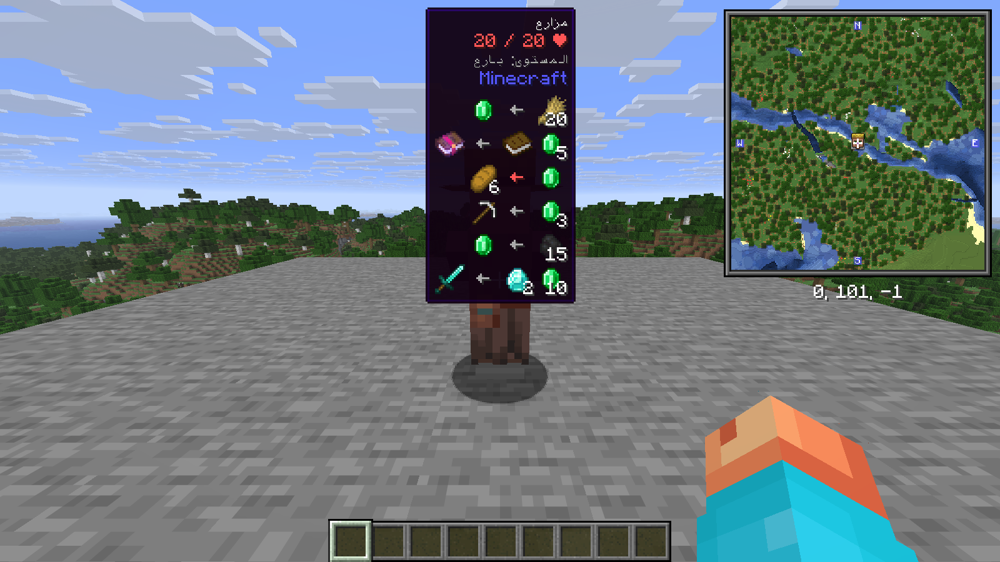

# Jade

What you are looking at, for [Horizon](https://playhorizon.dev) (Minecraft: Java Edition 26.3 in Rust, mod API 0.2): a tooltip at the top of the screen for the block or entity under the crosshair. A native mod, in English, French and Arabic; in a right-to-left language the box mirrors (icon on the right, lines and item rows from the right).

## Screenshots

| Block | Crop growth | Furnace |
| --- | --- | --- |
|  |  |  |

A villager's trades (in Arabic the box mirrors, so the arrows point left; the used-up bread trade's arrow is red):



## What it shows

- **Block**: icon, name (in the game's language), originating mod, and depending on the block:
  - crop growth (wheat, carrots, potatoes, beetroots, melon and pumpkin stems, cocoa, nether wart, sweet berries, torchflower, pitcher plant, and any modded crop with an `age` property): "Growth: 57%" or "Mature";
  - honey level and bee count of a hive, compost level, respawn anchor charges, farmland moisture, turtle and sniffer egg hatching, cake slices left;
  - redstone: power (wire, daylight detector, target, sculk sensors, weighted pressure plates), repeater delay, comparator mode, lever state;
  - a note block's note and instrument, a jukebox's disc, a spawner's mob;
  - a container's contents (chest, barrel, hopper, furnace, campfire…), merged by item, up to 18 icons with counts; "Unopened loot" for a structure chest never opened; nothing for a locked container;
  - cooking progress of a furnace, smoker or blast furnace, brewing progress of a brewing stand;
  - whether the item in your hand can harvest the block;
  - a progress bar while mining.
- **Entity**: name, health (❤ 18 / 20), originating mod, and depending on the entity:
  - animals: time until adulthood, until they can breed again, love mode, next egg (chickens);
  - tamed animals: owner;
  - horses, donkeys, mules, llamas: speed (blocks/s), jump height (blocks), llama strength;
  - villagers: level (and profession when the name doesn't already say it), and their first 6 trades as icons, one row each: cost (one or two) → result with counts, a red arrow when out of stock (a villager nobody has traded with has none yet); a zombie villager being cured: time left;
  - active effects (name, level, duration);
  - item frame: the item it holds; primed TNT: time until it explodes.

**Numpad 0** shows or hides the tooltip (rebindable in Options > Controls).

## Settings

**Options > Mods > Jade > Config**: theme (Vanilla, Dark, Light, Waila), position (top centre, left, right), size (0.5 to 2), and one toggle per kind of information.

Health, animal, villager and horse data, trades, effects, contents and furnace/brewing progress are known only to the server: the mod asks for them a few times per second, for a target within 24 blocks. On a server without this mod the tooltip still works, without those lines.

## Install

Needs [Kit](https://github.com/ameliiom/kit) 0.1 or later, the shared code of these mods, installed the same way (`kit.hmod`, `mod.kit:true`).

1. Copy `jade.hmod` into `%APPDATA%\horizon\horizon-native-mods\`.
2. Add the line `mod.jade:true` to `%APPDATA%\horizon\horizon-mods.txt`.
3. Build: in the launcher's Mods page press **Build**, or run `horizon-launcher native-build --instance horizon --trust-native-code`. A native mod runs with your rights: install it only from a source you trust.
4. Play.

Built for Horizon Nightly `f037744` (2026-11-21).

## Build

```powershell
cargo horizon-mod build
```

The source package is `target\horizon-mod\jade.hmod`; the launcher compiles it (step 3 above).

## Licence and credits

CC BY-NC-SA 4.0 (see [LICENSE](LICENSE) and [NOTICE](NOTICE)): non-commercial use only. Adapted from [Jade](https://github.com/Snownee/Jade) by Snownee and contributors and from [jade-horizon](https://github.com/Pierddev/jade-horizon) by Pierddev. No Minecraft assets or data are included. Not affiliated with Snownee, Pierddev or the Horizon project.
